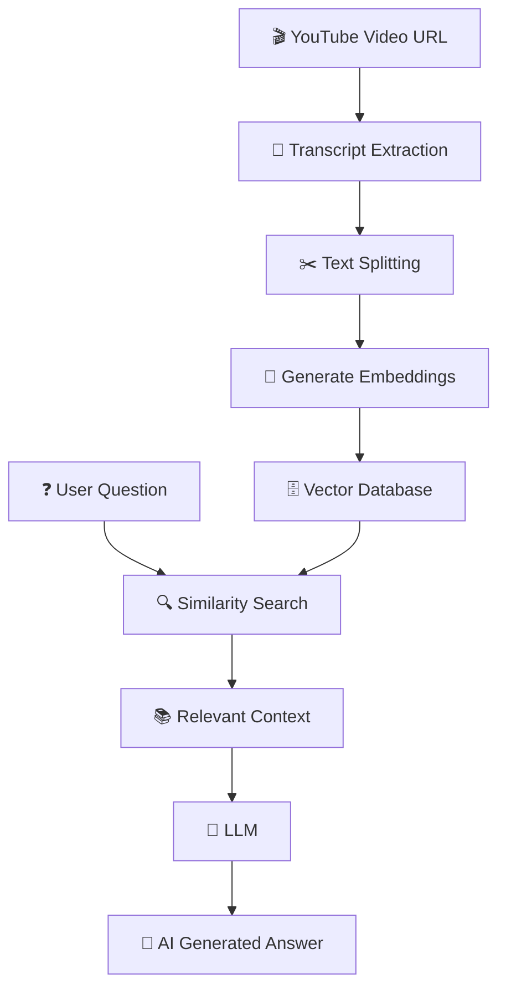

# 🎥 YT Chatbot — Chat With Any YouTube Video! 🤖

<p align="center">
  
  
  
  
</p>

<p align="center">
  <b>🚀 Don't watch the entire video. Just ask it!</b>
</p>

---

## 🌟 About The Project

**YT Chatbot** is an AI-powered application that allows users to interact with YouTube videos through natural language conversations.

Instead of watching an entire video to find specific information, simply provide a YouTube video and ask questions. The chatbot retrieves relevant information from the video's transcript and generates context-aware answers using Large Language Models (LLMs).

Built using **LangChain, OpenAI and Retrieval-Augmented Generation (RAG)**.

## ✨ Features

- 🎬 **YouTube Transcript Extraction** – Extract captions directly from YouTube videos.
- ✂️ **Smart Text Chunking** – Split lengthy transcripts into manageable chunks.
- 🧠 **Semantic Embeddings** – Convert text into meaningful vector representations.
- 🔍 **Contextual Retrieval** – Retrieve relevant information based on user queries.
- 💬 **Conversational AI** – Ask questions and get intelligent responses.
- ⚡ **RAG Pipeline** – Generate answers grounded in retrieved video content.

## 🛠️ Tech Stack

| Technology | Purpose |
|---|---|
| 🐍 Python | Core Programming Language |
| 🔗 LangChain | LLM Application Framework |
| 🎥 YouTube Transcript API | Transcript Extraction |
| ✂️ RecursiveCharacterTextSplitter | Text Chunking |
| 🧠 OpenAI Embeddings | Text Embeddings |
| 🤖 ChatOpenAI | Language Model |
| 🔐 Python Dotenv | Environment Variables |

## 🔄 How It Works



## 📦 Installation & Setup

### 1️⃣ Clone the Repository

```bash
git clone YOUR_REPOSITORY_URL
cd YT_Chatbot
```

### 2️⃣ Create a Virtual Environment

```bash
python -m venv venv
```

Activate it:

**Windows:**
```bash
venv\Scripts\activate
```

**Linux / macOS:**
```bash
source venv/bin/activate
```

### 3️⃣ Install Dependencies

```bash
pip install langchain langchain-core langchain-openai langchain-text-splitters youtube-transcript-api python-dotenv tiktoken
```

### 4️⃣ Configure Environment Variables

Create a `.env` file in the project root directory:

```env
OPENAI_API_KEY=your_openai_api_key
```

⚠️ Never share your API key publicly or commit your `.env` file to GitHub.

### 5️⃣ Run the Project

```bash
python app.py
```

*Note: Update the execution command according to your application's entry-point file.*

## 📂 Project Structure

```text
YT_Chatbot/
│
├── 📁 venv/
├── 📄 .env
├── 📄 .gitignore
├── 📄 app.py
├── 📄 requirements.txt
└── 📄 README.md
```

## 🧠 What I Am Learning Through This Project

- Understanding LangChain components.
- Working with YouTube transcript extraction.
- Exploring text splitting strategies.
- Understanding embeddings and vector representations.
- Implementing Retrieval-Augmented Generation (RAG).
- Connecting LLMs with external knowledge sources.

## 🚧 Future Improvements

- [ ] 🌐 Build an interactive Streamlit interface.
- [ ] 📚 Support multiple YouTube videos.
- [ ] 💾 Integrate a persistent vector database.
- [ ] 🕒 Add timestamp-based source references.
- [ ] 💬 Implement conversational memory.
- [ ] 🌍 Support multilingual transcripts.

## 🤝 Contributions

Suggestions, feedback and contributions are always welcome!

Feel free to fork this repository and experiment with your own ideas.

## 👨‍💻 Author

**Shakti Kumar Suraj**

🎓 CSE Undergraduate | IIIT Ranchi  
💡 AI/ML & Generative AI Enthusiast

---

<p align="center">
  ⭐ If you find this project interesting, consider giving it a star!
  <br/>
  <b>Built with ❤️, Python and a curiosity for AI.</b>
</p>
